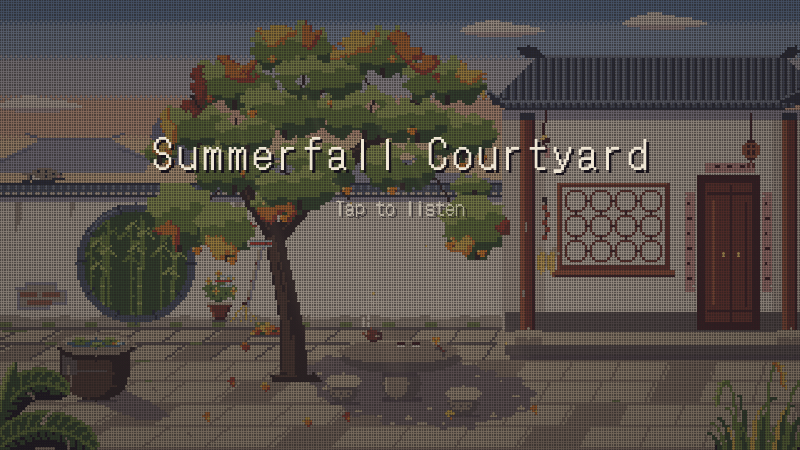
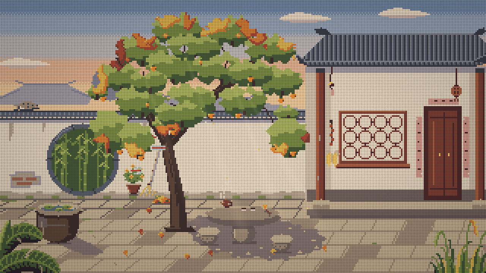
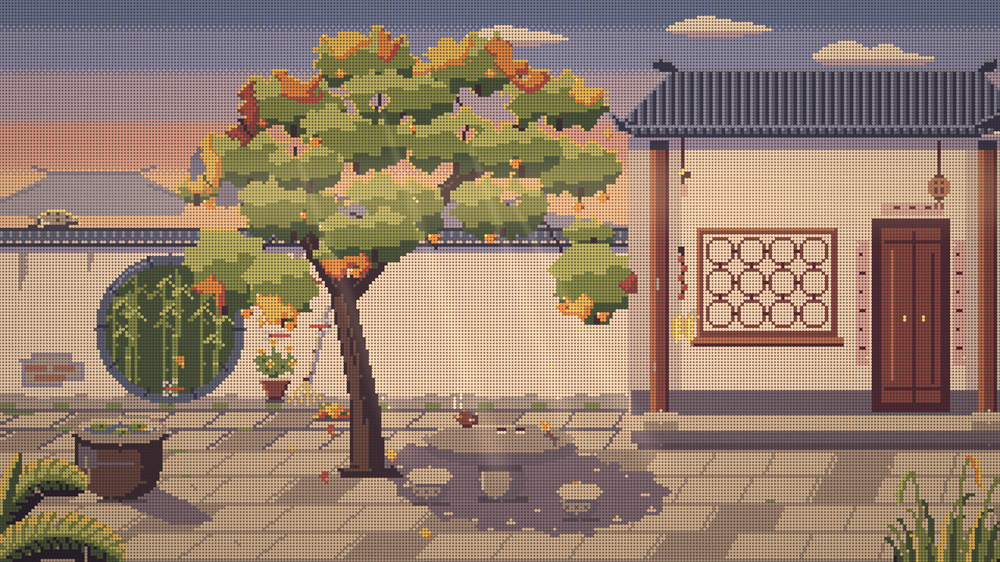
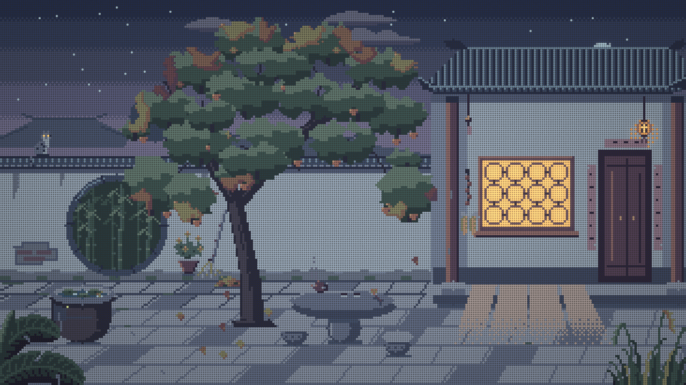
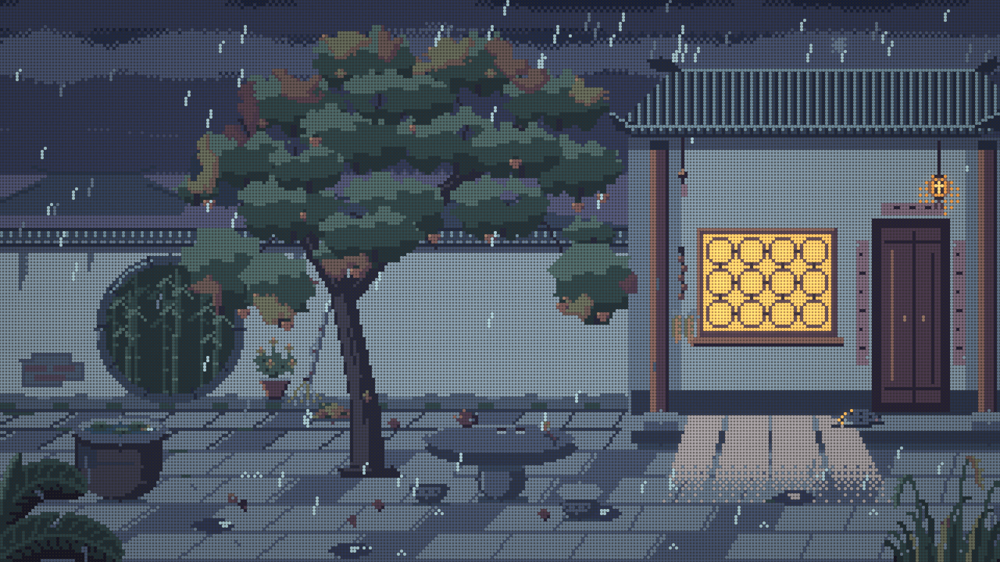

# Summerfall Courtyard

An endless, generative pixel-art courtyard at the end of summer. One day lasts 15 minutes and loops forever: afternoon, sunset, dusk, night, a late-night rain, and dawn, then back to afternoon. A persimmon tree sheds leaves in the wind, dragonflies and swallows pass through, fireflies come out at night, and a tabby cat sleeps on the wall until the rain sends it running for the eaves.

**Live:** https://5o1.github.io/summerfall-courtyard/ (click once to turn on the sound)

| Afternoon | Sunset |
|---|---|
|  |  |
| **Night** | **Late-night rain** |
|  |  |

The whole piece is a single `index.html` (about 180 KB). It uses no libraries, images, or audio files. Every pixel is drawn by code and every sound is synthesized live with the Web Audio API. The only external request is an optional Google Fonts stylesheet for the title font.

## Controls

- **Click / tap** the scene to start the sound.
- **Control bar** (bottom right, hides itself when the mouse is idle): time of day, sound on/off, volume, display style, light effects.
- **Display styles:** pixel, cross-stitch, glazed tile. **Light effects** toggles the soft light rays, horizon haze, dawn fog, glow, and grain. Both choices are remembered.
- **Keyboard:** `M` mutes, `F` toggles fullscreen, `Tab` moves through the controls.

## How it was made

### 1. Spec first, code second

The project started as a written spec: a full art bible (palette, composition, pixel-art rules), an animation list, a music brief, a list of quality gates, and a plan that split the work into stages. Each stage had to stop for review before the next one could start.

The work was split between two AI agents and a human:

- **Claude** (Anthropic) was the art director and code reviewer. It wrote the spec, reviewed every stage from screenshots, frame strips, videos, spectrograms, and loudness measurements, and wrote a ruling for each review: what passed, what to redo, and exactly how.
- **Codex** (OpenAI's coding agent) wrote most of the code. It implemented each stage, rendered its own review material with headless Chrome, ran the gates, and wrote a stage report with measurements, bugs fixed, and any choices it made beyond the spec.
- **The author** watched and listened to the results and gave the feedback that set the direction: make the loop longer and let the music develop, add rain late at night, add hand-made display styles, and make the cat's walk and the foreground plants feel less fake.

There were 26 rulings over 9 stages. The last stage, the cat's walk cycle and the foreground plants, was written by Claude directly at the author's request.

### 2. Rendering: a real indexed-color pixel engine

- **Native resolution 320×180.** Everything is drawn into a `Uint8Array` of palette indices, not into RGB. Only the last step turns indices into colors and uploads the frame.
- **48-color palette with keyframes.** The same indices have a color in each of six keyframes (afternoon, late afternoon, sunset, blue hour, night, dawn). The time of day is just a smooth blend between keyframes, so all lighting changes together. This is the color-cycling idea from Mark Ferrari's classic pixel art. Lamps, lit windows, and fireflies are indices that match their surface in daytime and turn warm and bright at night, so "lighting the lamps" is purely a palette change.
- **No anti-aliasing anywhere.** The canvas `arc`, `lineTo`, gradient, alpha, and scaled `drawImage` APIs are banned. All shapes come from hand-written routines: horizontal spans, rectangles, Bresenham lines, integer ellipses, and sprite blits. Sprites are character grids in the source. All motion is rounded to whole pixels, and sprite animation runs at 6–12 fps like hand-drawn frames.
- **A gate that checks every frame.** `__scene.frameStats()` counts the real canvas pixels and verifies that none of them falls outside the current palette.
- **Display layer (WebGL).** The 320×180 frame is uploaded as a texture and redrawn at screen resolution by one fragment shader:
  - *Cross-stitch*: every pixel becomes an X-shaped stitch with thread sheen over a linen ground, with small per-stitch jitter so it looks hand-made.
  - *Glazed tile*: every pixel becomes a small glazed ceramic tile.
  - *Light effects*: soft light rays through the canopy, horizon haze, ground fog after the rain, glow, vignette, and grain.

  If WebGL is unavailable, the page falls back to plain pixels.
- **A lesson learned the hard way.** Soft translucent effects (light shafts, haze, fog) were first done with ordered dithering inside the 320×180 grid. At that size, large low-density dithering always reads as a screen-door pattern; the same problem showed up three times. The fix was a rule: the pixel layer only holds crisp pixel elements, and anything soft and translucent lives in the display layer.

### 3. Time and determinism

- A day is 900 seconds: afternoon 4 min, sunset 3 min, dusk 2.5 min, night 3.75 min, dawn 1.75 min. When the 900 seconds are up, the day continues into the next afternoon with no reset.
- Two clocks are kept apart on purpose. "What time of day is it" (palette, lamps, which creatures are out, when the cat wakes) follows the day phase. "How long does an action take" (wind gusts, falling leaves, a stretch, a blink) stays in real seconds, so stretching the day never slows the motion down.
- All randomness comes from a seeded PRNG (`mulberry32`); `Math.random()` is never used. Any moment can be reproduced exactly from `?seed=…&t=…&pause`, which is what made pixel-by-pixel screenshot review possible.

### 4. Animation

- **One wind for everything.** A global `wind(t)` combines slow sine breezes with seeded gust events. Leaf clusters, bamboo, falling leaves, the wind chime, the steam from the teapot, the foreground grass, and the wind sound all read from it. Gusts are broadcast on an event bus so the audio can ring the chimes.
- **Life on a schedule:** dragonflies that hover and dart, swallows heading south at sunset, stars and a rising moon, fireflies, cicadas giving way to crickets.
- **Rain:** late in the night, layered clouds roll in and it rains from around t = 700 s until shortly before the loop returns to afternoon. The ground darkens, puddles form and dry out, and morning fog rises after the rain.
- **The cat.** It walks along the wall, crouches, jumps down, and trots through the rain to shelter under the eave. After the rain it walks back, sniffs a puddle, jumps up, and curls up again before the day restarts. The walk is an 8-frame lateral-sequence gait and the trot a 6-frame diagonal gait. Body movement comes from a per-frame table built so that a paw on the ground never moves in world space (no "moonwalking"). The 72 cat sprites are generated from a procedural side-view pose.
- **Foreground plants.** A banana plant and a clump of grass with foxtails are drawn in segments. The tips sway the most, and the foxtail heads overshoot and settle after a gust. At sunset the banana leaves glow yellow-green where the light shines through them.

### 5. Music and sound

The score is generative, not a looped track. It is built so it can play indefinitely without repeating itself.

- **Mode:** D gong pentatonic (D E F♯ A B), moving toward B yu at night.
- **Instruments, all synthesized:**
  - a guzheng-like plucked string made with Karplus–Strong synthesis, including the characteristic pitch bend into a note;
  - a guqin-like string with harmonics for the night;
  - xiao and xun flutes with breath noise and deepening vibrato;
  - a soft pad and bass;
  - temple bells at dusk and dawn.
- **Composition:** a set of short pentatonic motifs arranged in A A′ B A″ phrases and varied only in controlled ways: shifting within the scale, rhythmic displacement, adding or removing ornaments, and changing the final note. Each part of the day has its own intro, development, and close, so the music changes character over the 15 minutes instead of looping a melody.
- **Ambience:** cicadas (afternoon), crickets (night), wind that follows the visual wind, wind chimes on gusts, birdsong at dawn, and layered rain.
- **Mix:** a convolution reverb whose impulse response is generated from decaying noise, plus a limiter. Loudness targets and peak limits were checked on every review.
- **Offline rendering:** the audio engine takes an `AudioContext` as a parameter, so the same scheduler can run in an `OfflineAudioContext`. That made it possible to export WAV files, spectrograms, and loudness measurements for review, and to give the review videos their soundtrack.

### 6. Review by gates

Every stage had to pass hard gates before review, including:

- zero console errors;
- every pixel on the palette;
- pixel-identical screenshots for the same seed and time;
- a single file with no external assets;
- working display styles, saved preferences, and correct jumps to any time.

Softer gates were measured and reported, not tuned to pass: frame time under 4 ms, peak and RMS loudness, the music-to-ambience level difference, and repetition in the melody. Review videos of the full 15-minute day were rendered frame by frame on a remote render node.

## Debug URL parameters

| Parameter | Effect |
|---|---|
| `?t=SECONDS` | jump to a time in the 900 s day |
| `?pause` | freeze time |
| `?seed=N` | change the random seed |
| `?speed=X` | time multiplier |
| `?debug` | show fps, time, and palette keyframe |
| `?noui` | hide all overlays |
| `?style=pixel\|stitch\|tile`, `?fx=0\|1` | override the display preferences |
| `?rain=0` | disable the rain |

For example, `?t=780&pause&noui` shows the rain at night with the cat under the eave.
